<div align="center">

МИНИСТЕРСТВО НАУКИ И ВЫСШЕГО ОБРАЗОВАНИЯ РОССИЙСКОЙ ФЕДЕРАЦИИ

Федеральное государственное автономное образовательное учреждение

высшего образования

**«СЕВЕРО-КАВКАЗСКИЙ ФЕДЕРАЛЬНЫЙ УНИВЕРСИТЕТ»**

<br>

Институт перспективной инженерии

Департамент цифровых робототехнических систем и электроники

<br>

**ОТЧЕТ К ПРАКТИЧЕСКОЙ РАБОТЕ № 1**

Тема: Настройка среды разработки и первый HTTP-сервер

Дисциплина: Информационные системы и технологии

</div>

<br><br><br>

<div style="text-align: right; margin-right: 8%;">

**Выполнил:**

Бахмадов Джамал Анзорович

1 курс, группа ПИЖ-б-о-25-2

Направление подготовки: 09.03.04

«Программная инженерия»

<br>

**Проверил:**

Заведующая МБК

Новикова Е.Н.

</div>

<br><br><br><br>

<div align="center">

Ставрополь 2026

</div>

<div style="page-break-after: always;"></div>

# Цель работы

Освоить установку инструментов для бэкенд-разработки, создать и запустить минимальный веб-сервер, обрабатывающий GET-запросы, понять концепцию эндпоинтов, научиться настраивать автоматический перезапуск сервера.

# Теоретическое обоснование

Бэкенд - это серверная часть веб-приложения, которая отвечает за обработку запросов от клиентов, выполнение серверной логики и формирование ответов. Веб-приложения работают по клиент-серверной архитектуре: клиент, например браузер, отправляет HTTP-запрос серверу, сервер обрабатывает этот запрос и возвращает HTTP-ответ. В данной лабораторной работе для создания серверной части используется Node.js совместно с веб-фреймворком Express. Node.js позволяет выполнять JavaScript на сервере, а Express упрощает создание веб-серверов, обработку HTTP-запросов и маршрутизацию.

Эндпоинт представляет собой конкретный адрес (URL) вместе с HTTP-методом, по которому клиент обращается к серверу для получения ресурса. В работе используется метод GET, предназначенный для запроса и получения данных от сервера. Для передачи структурированных данных применяется формат JSON (JavaScript Object Notation), который широко используется в REST API. Для упрощения разработки также используется автоматический перезапуск сервера: в Node.js для этого применяется пакет Nodemon, который позволяет автоматически перезапускать сервер при изменении исходного кода.

# Выполнение практического примера

Для выполнения практического примера была настроена среда разработки Node.js. Сначала был создан новый проект с помощью команды `npm init -y`, после чего были установлены фреймворки Express и Nodemon.

<div align="center">

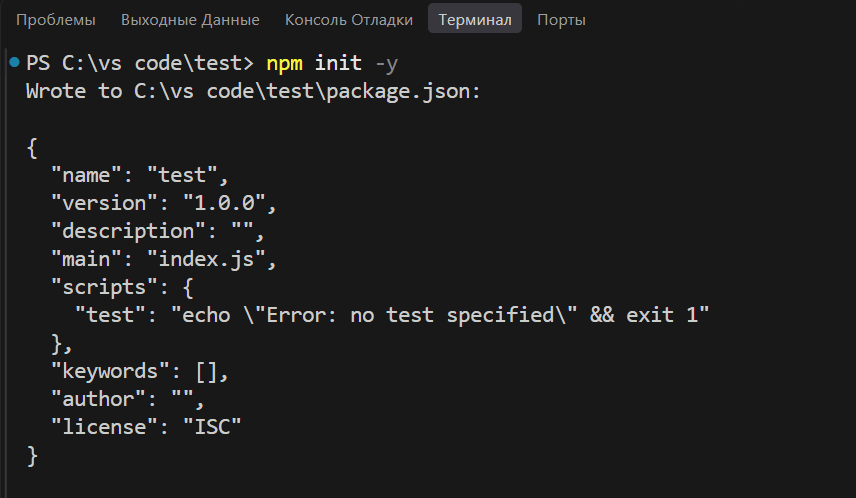

**Рисунок 1 - Инициализация проекта**

</div>

<div align="center">

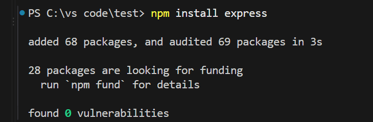

**Рисунок 2 - Установка Express**

</div>

<div align="center">

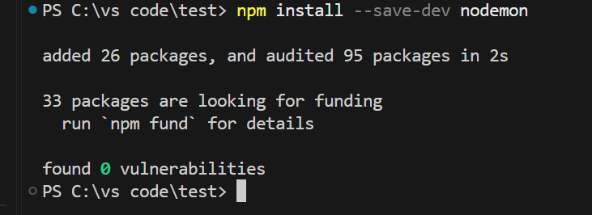

**Рисунок 3 - Установка Nodemon**

</div>

В файле `app.js` был реализован сервер с использованием Express, содержащий текстовый и JSON-эндпоинты, параметризованный маршрут и обработку ошибки 404.

<div align="center">

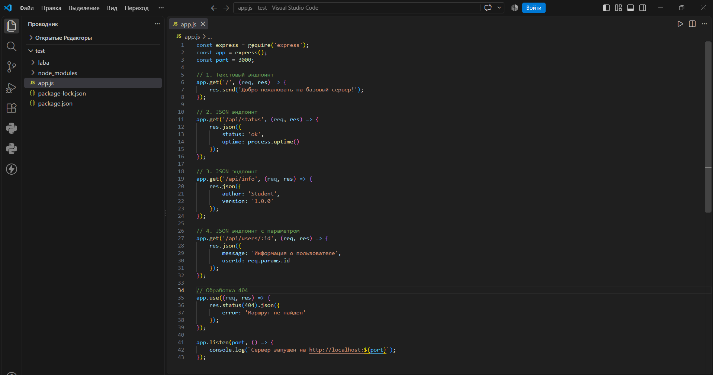

**Рисунок 4 - Код сервера Express**

</div>

Для запуска сервера используется команда:

```bash
npm run dev
```

Сервер запускается с использованием Nodemon, который автоматически перезапускает приложение при изменении исходного кода.

<div align="center">

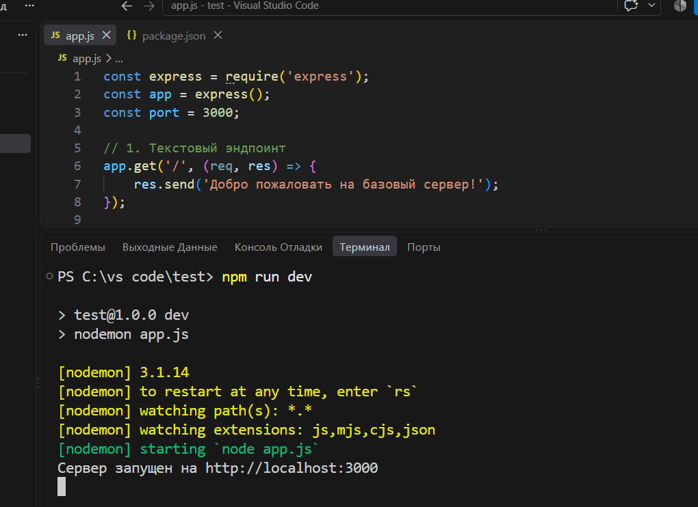

**Рисунок 5 - Запуск сервера с использованием Nodemon**

</div>

Для проверки работы сервера в браузере были выполнены GET-запросы к реализованным эндпоинтам.

<div align="center">

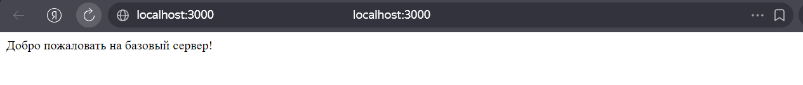

**Рисунок 6 - Результат обращения к корневому endpoint /**

</div>

<div align="center">

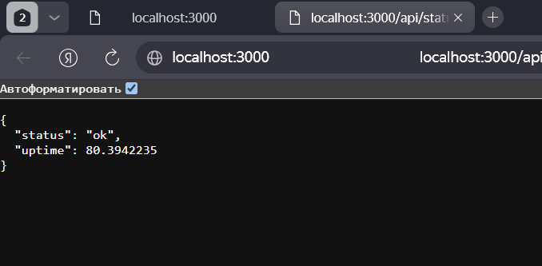

**Рисунок 7 - Результат обращения к JSON endpoint /api/status**

</div>

<div align="center">

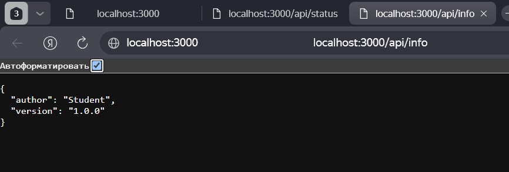

**Рисунок 8 - Результат обращения к JSON endpoint /api/info**

</div>

<div align="center">

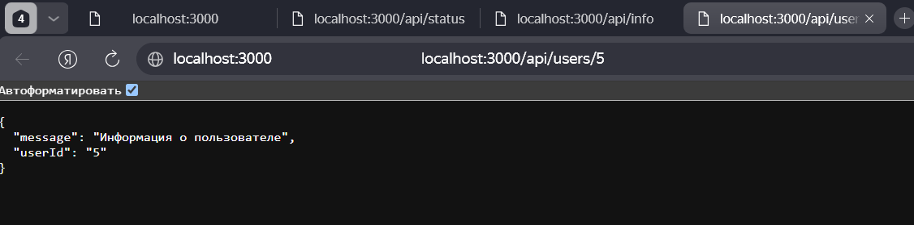

**Рисунок 9 - Результат обращения к параметризованному endpoint /api/users/5**

</div>

<div align="center">

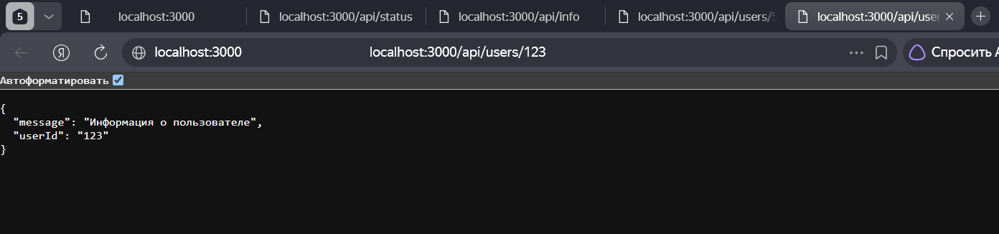

**Рисунок 10 - Результат обращения к параметризованному endpoint /api/users/123**

</div>

<div align="center">

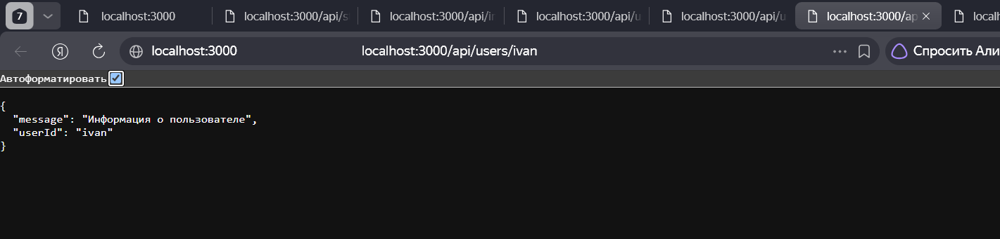

**Рисунок 11 - Результат обращения к параметризованному endpoint /api/users/ivan**

</div>

Для проверки обработки несуществующего маршрута был выполнен запрос к адресу `/anything-else`.

<div align="center">

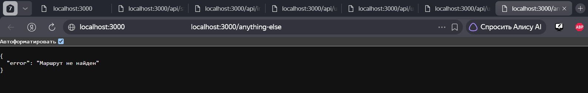

**Рисунок 12 - Результат обработки ошибки 404 Not Found**

</div>

# Выполнение индивидуальных заданий

## Задание 1. Базовый уровень

Требования: 2 эндпоинта (1 текстовый на корневом маршруте `/` и 1 JSON). Настроить автоматический перезапуск.

Для выполнения первого индивидуального задания был реализован текстовый endpoint `/` и JSON endpoint `/api/status`. Сервер запускается с помощью Nodemon.

<div align="center">

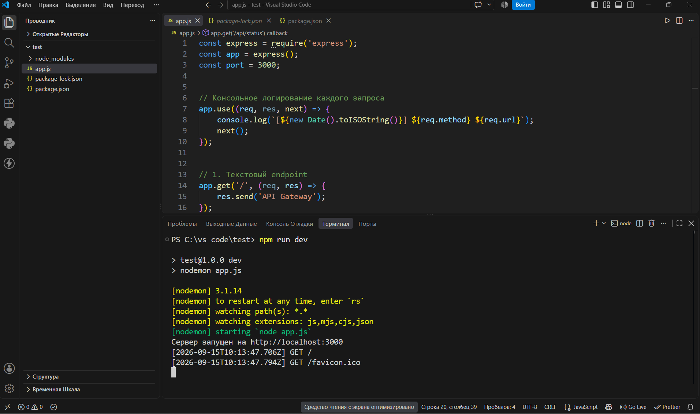

**Рисунок 13 - Запуск сервера с использованием Nodemon**

</div>

<div align="center">

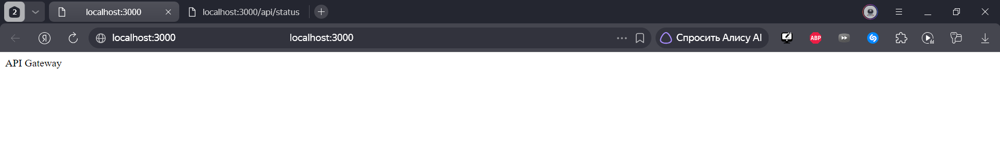

**Рисунок 14 - Результат обращения к корневому endpoint /**

</div>

<div align="center">

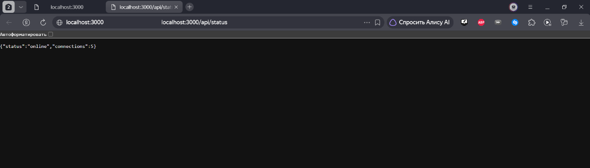

**Рисунок 15 - Результат обращения к JSON endpoint /api/status**

</div>

## Задание 2. Средний уровень

Требования: 3 эндпоинта (1 текстовый на `/` и 2 различных JSON-эндпоинта). Настроить автоматический перезапуск. Добавить кастомную обработку ошибки 404 (Not Found) с возвратом JSON формата `{"error": "Not Found"}`.

Согласно варианту 6 были реализованы следующие эндпоинты:

- `/` - текстовый ответ `API Gateway`;

- `/api/students` - статический список студентов в формате JSON;

- `/api/groups` - статический список групп в формате JSON.

Также была добавлена обработка несуществующих маршрутов с кодом состояния 404 и JSON-ответом об ошибке.

<div align="center">

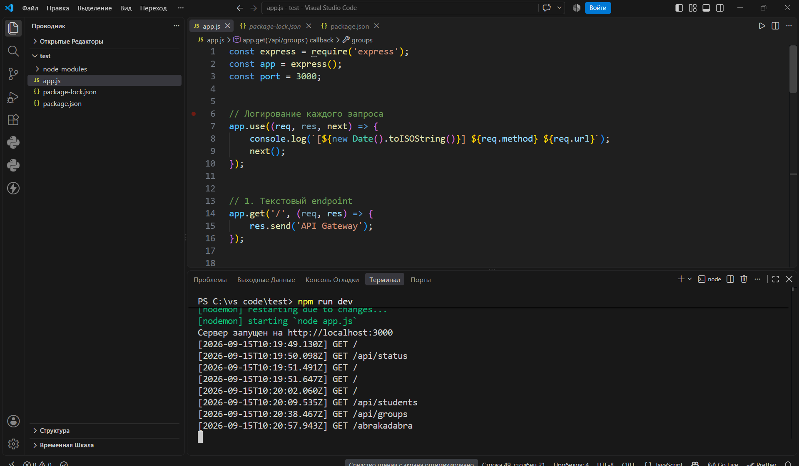

**Рисунок 16 - Запуск сервера с использованием Nodemon**

</div>

<div align="center">

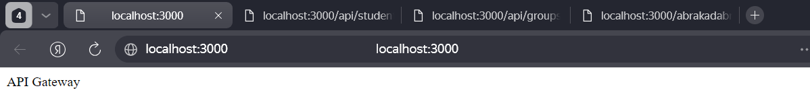

**Рисунок 17 - Результат обращения к корневому endpoint /**

</div>

<div align="center">

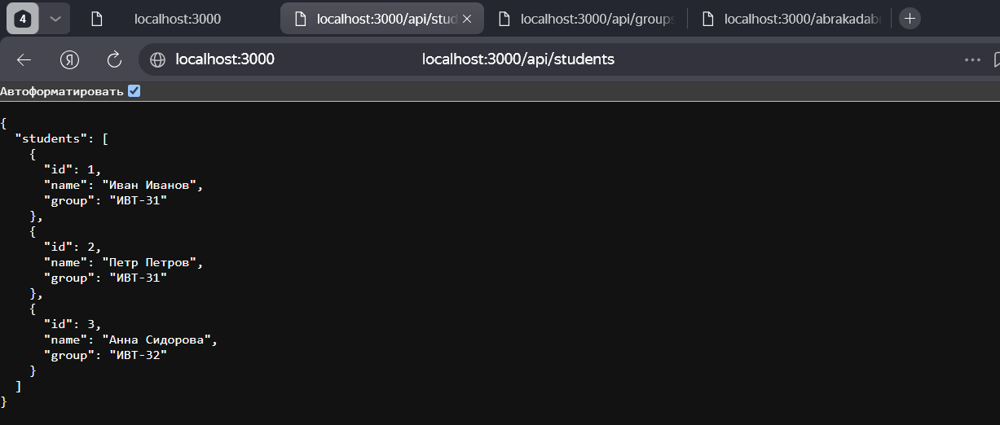

**Рисунок 18 - Результат обращения к JSON endpoint /api/students**

</div>

<div align="center">

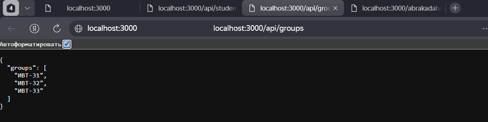

**Рисунок 19 - Результат обращения к JSON endpoint /api/groups**

</div>

<div align="center">

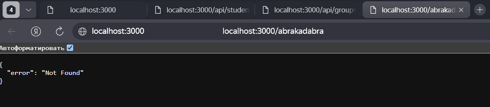

**Рисунок 20 - Результат обработки ошибки 404 Not Found**

</div>

# Контрольные вопросы

### 1. Что такое клиент-серверная архитектура?
Клиент-серверная архитектура это – модель взаимодействия, при которой клиент отправляет запрос серверу, а сервер обрабатывает его и возвращает ответ. В качестве клиента может выступать браузер или мобильное приложение, а сервером является бэкенд-приложение.

### 2. Какой протокол используется для общения клиента и сервера в вебе?
Для взаимодействия клиента и сервера в вебе используется протокол HTTP (HyperText Transfer Protocol). С его помощью клиент отправляет запросы серверу, а сервер возвращает HTTP-ответы.

### 3. Что такое эндпоинт (endpoint)?
Эндпоинт - это конкретный адрес URL вместе с HTTP-методом, по которому клиент обращается к серверу для получения или передачи данных. Например, GET /api/students является эндпоинтом серверного приложения.

### 4. Какую структуру имеет HTTP-запрос и HTTP-ответ? Что такое код состояния (status code)?
HTTP-запрос содержит метод, URL и дополнительные данные, необходимые серверу для обработки запроса. HTTP-ответ содержит код состояния, заголовки и тело ответа. Код состояния показывает результат обработки запроса сервером. Например, код 200 означает успешное выполнение запроса, а 404 означает, что запрошенный ресурс или маршрут не найден.

### 5. Что такое JSON? Почему он популярен в веб-разработке?
JSON (JavaScript Object Notation) - текстовый формат обмена данными, широко используемый в веб-разработке и REST API. Он удобен для представления структурированных данных и легко обрабатывается JavaScript и другими языками программирования.

### 6. Как запустить сервер на Node.js с использованием Express?
Для запуска сервера в режиме разработки используется команда npm run dev, которая запускает приложение с помощью Nodemon. Для обычного запуска используется команда npm start.

### 7. Что такое автоматический перезапуск сервера и как он реализуется в Node.js?
Автоматический перезапуск позволяет серверу самостоятельно перезапускаться при изменении исходного кода. В Node.js для этого используется инструмент Nodemon, который отслеживает изменения файлов и автоматически перезапускает приложение.

### 8. Какие коды состояния HTTP вы знаете? За что отвечает код 404?
Код 200 означает успешную обработку запроса, 301 – перенаправление, 400 – некорректный запрос, 404 – запрашиваемый ресурс не найден, 500 – внутренняя ошибка сервера. Код 404 используется, когда запрошенный маршрут отсутствует на сервере.

# Вывод

В ходе практической работы была настроена среда разработки для создания серверных приложений на Node.js. Был создан HTTP-сервер с использованием фреймворка Express, реализованы текстовые и JSON-эндпоинты, а также настроен автоматический перезапуск сервера с помощью Nodemon. В индивидуальных заданиях были созданы необходимые маршруты для 6 варианта и реализована обработка ошибки 404 с возвратом ответа в формате JSON.

В ходе выполнения работы были изучены основные принципы клиент-серверного взаимодействия, понятия HTTP-запроса, эндпоинта и JSON. Также был получен практический опыт запуска сервера, обработки GET-запросов и проверки результатов через браузер.

В процессе выполнения возникали трудности с настройкой `package.json` и запуском сервера через Nodemon. После добавления необходимых скриптов запуска и настройки файла `app.js` сервер был успешно запущен и все реализованные эндпоинты были проверены.

# Список использованных источников

1. Node.js Documentation - https://nodejs.org/docs/latest/api/

2. Express.js Documentation - https://expressjs.com/

3. npm Documentation - https://docs.npmjs.com/

4. Nodemon Documentation - https://nodemon.io/

5. MDN Web Docs - HTTP - https://developer.mozilla.org/en-US/docs/Web/HTTP