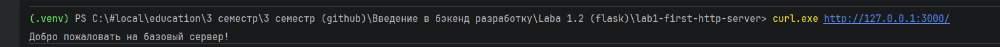
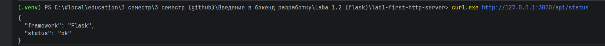
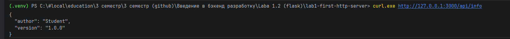
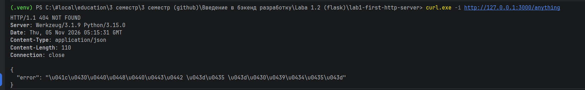

# Лабораторная работа №1
## Настройка среды разработки и первый HTTP-сервер

**Студент:** Бахмадов Джамал Анзорович  
**Группа:** ПИЖ-б-о-25-2  
**Вариант:** 6  
**Технология:** Python + Flask

## 1. Цель работы

Освоить настройку среды разработки для backend-приложений, создать и запустить HTTP-сервер с использованием Flask, научиться обрабатывать GET-запросы, отправлять ответы в форматах текста и JSON, понять концепцию эндпоинтов и настроить автоматический перезапуск сервера.

## 2. Теоретическое обоснование

Backend (бэкенд) — серверная часть веб-приложения, которая отвечает за обработку запросов клиентов, выполнение бизнес-логики и формирование ответов.

Веб-приложения используют клиент-серверную архитектуру. Клиент отправляет HTTP-запрос серверу, сервер обрабатывает его и возвращает HTTP-ответ.

Маршрут (route) определяет, какой обработчик будет вызван при обращении к определённому URL. Эндпоинт (endpoint) представляет собой конкретный адрес вместе с HTTP-методом. JSON — текстовый формат обмена данными, широко применяемый при создании API.

## 3. Выполнение практической части

### 3.1. Настройка среды разработки

Было создано виртуальное окружение Python с помощью команды:

```bash
python -m venv .venv
```

После создания и активации виртуального окружения был установлен Flask:

```powershell
.venv\Scripts\Activate.ps1
python -m pip install flask
```

Для сохранения зависимостей проекта использовалась команда:

```powershell
pip freeze > requirements.txt
```

### 3.2. Создание и запуск HTTP-сервера

Для практического примера был создан файл `example.py`, содержащий текстовый эндпоинт, два JSON-эндпоинта и обработчик ошибки 404.

Для запуска сервера использовалась команда:

```bash
python example.py
```

Сервер запускался локально на порту 3000. Для остановки сервера использовалась комбинация клавиш `Ctrl + C` в терминале.

### 3.3. Проверка работы сервера

Для проверки практического примера использовались следующие адреса:

- `http://127.0.0.1:3000/`
- `http://127.0.0.1:3000/api/status`
- `http://127.0.0.1:3000/api/info`
- `http://127.0.0.1:3000/anything`

**Главная страница практического примера:**



**JSON-эндпоинт со статусом сервера:**



**JSON-эндпоинт с информацией:**



**Обработка ошибки 404:**



### 3.4. Исходный код практического примера

```python
from flask import Flask, jsonify

app = Flask(__name__)


# 1. Текстовый эндпоинт
@app.route('/')
def home():
    return 'Добро пожаловать на базовый сервер!'


# 2. JSON-эндпоинт: статус сервера
@app.route('/api/status')
def status():
    return jsonify({
        "status": "ok",
        "framework": "Flask"
    })


# 3. JSON-эндпоинт: информация
@app.route('/api/info')
def info():
    return jsonify({
        "author": "Student",
        "version": "1.0.0"
    })


# 4. Обработка ошибки 404
@app.errorhandler(404)
def not_found(error):
    return jsonify({
        "error": "Маршрут не найден"
    }), 404


# Запуск сервера
if __name__ == '__main__':
    app.run(port=3000, debug=True)
```

## 4. Выполнение индивидуального задания

**Вариант 6. Средний уровень.**

В ходе выполнения индивидуального задания были реализованы три эндпоинта:

| HTTP-метод | Маршрут | Назначение |
|---|---|---|
| GET | `/` | Возвращает текстовое приветствие |
| GET | `/api/students` | Возвращает список студентов в JSON |
| GET | `/api/groups` | Возвращает список групп в JSON |

Дополнительно была реализована обработка ошибки 404 с возвратом JSON-ответа и статусом HTTP 404:

```json
{
    "error": "Not Found"
}
```

Для автоматического перезапуска сервера при изменении исходного кода использовался параметр `debug=True`.

### 4.1. Проверка работы индивидуального задания

Для проверки использовались следующие адреса:

- `http://127.0.0.1:3000/`
- `http://127.0.0.1:3000/api/students`
- `http://127.0.0.1:3000/api/groups`
- `http://127.0.0.1:3000/api/grrrr`

**Главная страница:**


**Список студентов в формате JSON:**


**Список групп в формате JSON:**


**Обработка ошибки 404:**


### 4.2. Автоматический перезапуск

Для проверки автоматического перезапуска была изменена строка в файле `app.py`. Flask обнаружил изменение исходного кода и автоматически перезапустил сервер.


### 4.3. Исходный код индивидуального задания

```python
from flask import Flask, jsonify

app = Flask(__name__)


# Главная страница
@app.route('/')
def home():
    return 'Добро пожаловать на сервер!'


# Список студентов
@app.route('/api/students')
def students():
    return jsonify({
        "students": [
            {"id": 1, "name": "Alex", "group": "ПИЖ-б-о-25-2"},
            {"id": 2, "name": "John", "group": "ПИЖ-б-о-25-2"},
            {"id": 3, "name": "Mike", "group": "ПИЖ-б-о-25-1"}
        ]
    })


# Список групп
@app.route('/api/groups')
def groups():
    return jsonify({
        "groups": [
            {"id": 1, "name": "ПИЖ-б-о-25-1"},
            {"id": 2, "name": "ПИЖ-б-о-25-2"},
            {"id": 3, "name": "ПИЖ-б-о-25-3"}
        ]
    })


# Обработка ошибки 404
@app.errorhandler(404)
def not_found(error):
    return jsonify({"error": "Not Found"}), 404


# Запуск сервера
if __name__ == '__main__':
    app.run(port=3000, debug=True)
```

## 5. Контрольные вопросы

**1. Что такое клиент-серверная архитектура?**

Это модель взаимодействия, при которой клиент отправляет запрос серверу, а сервер обрабатывает его и возвращает ответ.

**2. Какой протокол используется для общения клиента и сервера в вебе?**

HTTP (HyperText Transfer Protocol).

**3. Что такое эндпоинт (endpoint)?**

Это конкретный URL вместе с HTTP-методом, по которому клиент обращается к серверу.

**4. Какую структуру имеет HTTP-запрос и HTTP-ответ? Что такое код состояния (status code)?**

HTTP-запрос содержит метод, URL, заголовки и при необходимости тело запроса. HTTP-ответ содержит код состояния, заголовки и тело ответа. Код состояния показывает результат обработки запроса сервером, например 200 означает успешное выполнение, а 404 — отсутствие запрошенного ресурса.

**5. Что такое JSON? Почему он популярен в веб-разработке?**

JSON — текстовый формат обмена данными. Он популярен благодаря простой структуре и удобству передачи данных между клиентом и сервером.

**6. Как запустить сервер на Flask?**

Для запуска Flask-приложения используется команда `python app.py`. В коде приложения должен быть предусмотрен запуск сервера с помощью `app.run()`.

**7. Что такое автоматический перезапуск сервера и зачем он нужен?**

Это механизм, позволяющий автоматически перезапускать сервер после изменения исходного кода. Во Flask для этого используется режим `debug=True`.

**8. Какие коды состояния HTTP вы знаете? За что отвечает код 404?**

Код 200 означает успешную обработку запроса, 301 — перенаправление, 400 — некорректный запрос, 404 — ресурс не найден, 500 — внутренняя ошибка сервера.

## 6. Вывод

В ходе лабораторной работы была настроена среда разработки Python и создан HTTP-сервер с использованием Flask.

В практической части был реализован сервер с текстовым и JSON-эндпоинтами, а также обработчиком ошибки 404.

В индивидуальном задании (вариант 6, средний уровень) были созданы эндпоинты для получения списка студентов и групп. Дополнительно была реализована обработка ошибки 404 с возвратом JSON-ответа и настроен автоматический перезапуск сервера.

В результате были закреплены знания о клиент-серверной архитектуре, HTTP-запросах, маршрутизации, формате JSON и принципах работы Flask.

## 7. Список использованных источников

1. Flask Documentation — https://flask.palletsprojects.com/
2. Python Documentation — https://docs.python.org/3/
3. MDN Web Docs. HTTP — https://developer.mozilla.org/ru/docs/Web/HTTP
4. MDN Web Docs. JSON — https://developer.mozilla.org/ru/docs/Web/JavaScript/Reference/Global_Objects/JSON
