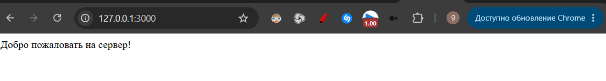
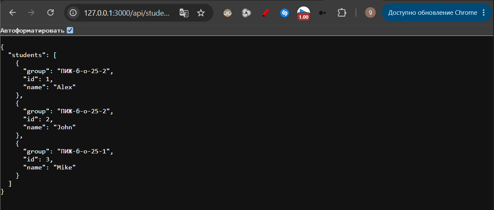
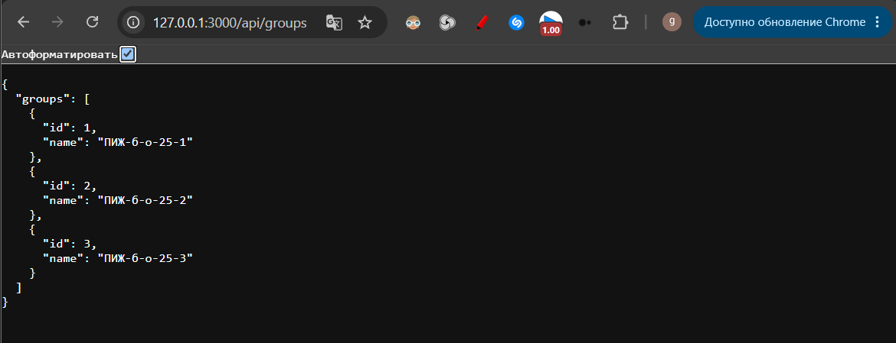
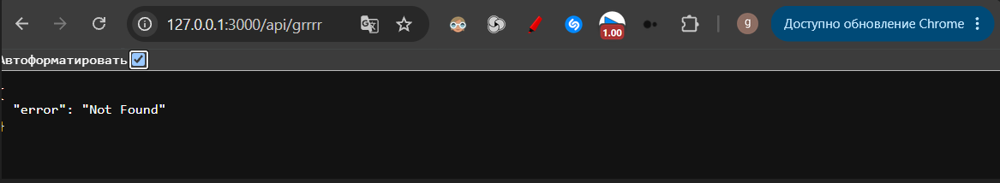
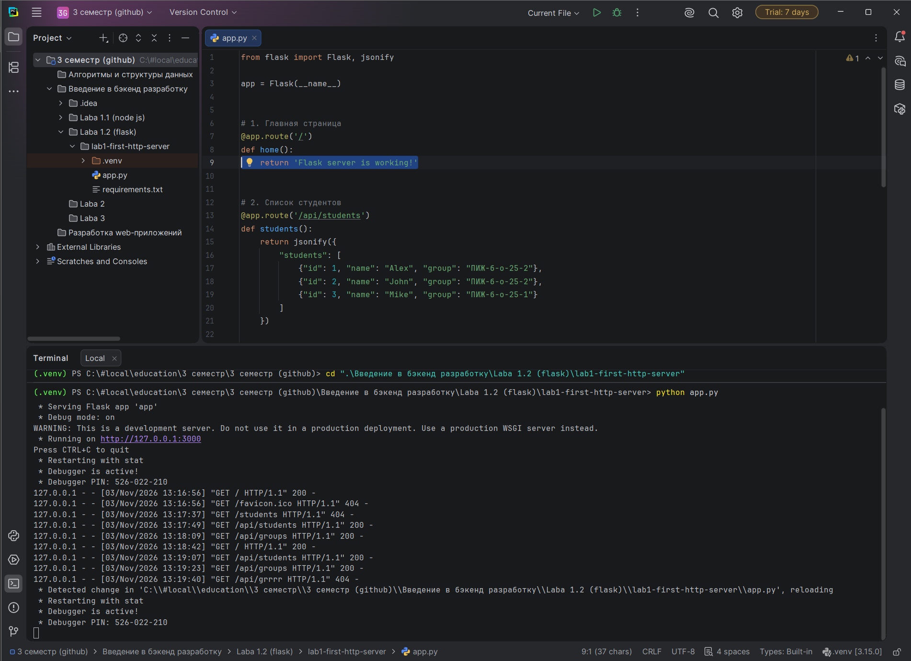

# Лабораторная работа №1
## Настройка среды разработки и первый HTTP-сервер

**Студент:** Бахмадов Джамал Анзорович  
**Группа:** ПИЖ-б-о-25-2  
**Вариант:** 6  
**Технология:** Python + Flask

## 1. Цель работы

Освоить настройку среды разработки для backend-приложений, создать и запустить HTTP-сервер с использованием Flask, научиться обрабатывать GET-запросы и отправлять ответы в форматах текста и JSON.

## 2. Теоретическое обоснование

Backend (бэкенд) — серверная часть веб-приложения, которая отвечает за обработку запросов клиентов, выполнение бизнес-логики и формирование ответов.

Веб-приложения используют клиент-серверную архитектуру. Клиент отправляет HTTP-запрос серверу, сервер обрабатывает его и возвращает HTTP-ответ.

Маршрут (route) определяет, какой обработчик будет вызван при обращении к определённому URL. Эндпоинт (endpoint) представляет собой конкретный адрес вместе с HTTP-методом. JSON — текстовый формат обмена данными, широко применяемый при создании API.

## 3. Выполнение практической части

### 3.1. Настройка среды разработки

Было создано виртуальное окружение Python с помощью команды:

```bash
python -m venv .venv
```

После активации виртуального окружения был установлен Flask:

```bash
python -m pip install flask
```

Для сохранения зависимостей проекта использовалась команда:

```bash
pip freeze > requirements.txt
```

### 3.2. Создание HTTP-сервера

Был создан файл `app.py`, содержащий маршруты Flask и обработчик ошибки 404.

Для запуска сервера использовалась команда:

```bash
python app.py
```

Сервер запущен локально на порту 3000.

### 3.3. Проверка работы сервера

Для проверки использовались следующие адреса:

- `http://127.0.0.1:3000/`
- `http://127.0.0.1:3000/api/students`
- `http://127.0.0.1:3000/api/groups`
- `http://127.0.0.1:3000/grrrr`

**Главная страница:**



**Список студентов в формате JSON:**



**Список групп в формате JSON:**



**Обработка ошибки 404:**



### 3.4. Автоматический перезапуск

Для автоматического перезапуска сервера при изменении исходного кода был использован режим `debug=True`.

При изменении файла `app.py` Flask обнаруживает изменения и автоматически перезапускает сервер.



## 4. Выполнение индивидуального задания

**Вариант 6. Средний уровень.**

В ходе выполнения индивидуального задания были реализованы три эндпоинта:

| HTTP-метод | Маршрут | Назначение |
|---|---|---|
| GET | `/` | Возвращает текстовое приветствие |
| GET | `/api/students` | Возвращает список студентов в JSON |
| GET | `/api/groups` | Возвращает список групп в JSON |

Дополнительно была реализована обработка ошибки 404 с возвратом JSON-ответа:

```json
{
    "error": "Not Found"
}
```

Для автоматического перезапуска сервера использовался параметр `debug=True`.

### Исходный код сервера

```python
from flask import Flask, jsonify

app = Flask(__name__)


# Главная страница
@app.route('/')
def home():
    return 'Добро пожаловать на сервер!'


# Список студентов
@app.route('/api/students')
def students():
    return jsonify({
        "students": [
            {"id": 1, "name": "Alex", "group": "ПИЖ-б-о-25-2"},
            {"id": 2, "name": "John", "group": "ПИЖ-б-о-25-2"},
            {"id": 3, "name": "Mike", "group": "ПИЖ-б-о-25-1"}
        ]
    })


# Список групп
@app.route('/api/groups')
def groups():
    return jsonify({
        "groups": [
            {"id": 1, "name": "ПИЖ-б-о-25-1"},
            {"id": 2, "name": "ПИЖ-б-о-25-2"},
            {"id": 3, "name": "ПИЖ-б-о-25-3"}
        ]
    })


# Обработка ошибки 404
@app.errorhandler(404)
def not_found(error):
    return jsonify({"error": "Not Found"}), 404


# Запуск сервера
if __name__ == '__main__':
    app.run(port=3000, debug=True)
```

## 5. Контрольные вопросы

**1. Что такое клиент-серверная архитектура?**

Это модель взаимодействия, при которой клиент отправляет запрос серверу, а сервер обрабатывает его и возвращает ответ.

**2. Какой протокол используется для общения клиента и сервера в вебе?**

HTTP (HyperText Transfer Protocol).

**3. Что такое эндпоинт (endpoint)?**

Это конкретный URL вместе с HTTP-методом, по которому клиент обращается к серверу.

**4. Что такое JSON? Почему он популярен в веб-разработке?**

JSON — текстовый формат обмена данными. Он популярен благодаря простоте структуры и удобству передачи данных между клиентом и сервером.

**5. Что означает HTTP-код 404?**

Код 404 Not Found означает, что запрошенный маршрут или ресурс не найден на сервере.

**6. Что такое автоматический перезапуск сервера и зачем он нужен?**

Это механизм, позволяющий автоматически перезапустить сервер после изменения исходного кода. Во Flask для этого используется режим `debug=True`.

## 6. Вывод

В ходе лабораторной работы была настроена среда разработки Python и создан HTTP-сервер с использованием Flask.

Были реализованы текстовый и JSON-эндпоинты, обработка ошибки 404 и автоматический перезапуск сервера.

В результате были закреплены знания о клиент-серверной архитектуре, HTTP-запросах, маршрутизации и формате JSON.

## 7. Использованные источники

1. Flask Documentation — https://flask.palletsprojects.com/
2. Python Documentation — https://docs.python.org/3/
3. MDN Web Docs. HTTP — https://developer.mozilla.org/ru/docs/Web/HTTP
4. MDN Web Docs. JSON — https://developer.mozilla.org/ru/docs/Web/JavaScript/Reference/Global_Objects/JSON